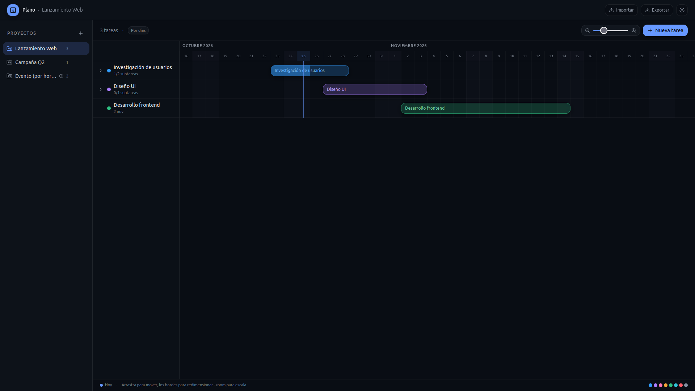

# Plano

Plano es una aplicación web minimalista para organizar proyectos con un diagrama de Gantt. Permite planificar tareas, ajustar fechas con arrastrar y soltar, dividir el trabajo en subtareas y guardar todo automáticamente en el navegador.



## Capacidades

1. **Proyectos múltiples**: crea, renombra y elimina proyectos; cada uno mantiene sus propias tareas.
2. **Escalas de tiempo por días u horas**: elige la precisión adecuada para cada proyecto.
3. **Línea de tiempo interactiva**: mueve tareas arrastrando y cambia su duración redimensionando los bordes.
4. **Zoom y ajuste (snap)**: adapta la vista y, en proyectos por horas, ajusta los movimientos a intervalos de 1 hora, 30 o 15 minutos.
5. **Tareas personalizables**: título, fecha de inicio y fin, ocho colores y notas libres.
6. **Subtareas**: añade, marca como completadas y elimina subtareas con seguimiento del progreso.
7. **Persistencia automática**: proyectos, tareas, subtareas y preferencias se guardan en `localStorage`.
8. **Importación y exportación JSON**: descarga todo el diagrama en un archivo y vuelve a importarlo con validación de formato.
9. **Tema claro y oscuro**: cambia el tema desde la barra superior; la preferencia se conserva.
10. **PWA instalable**: incluye manifest, iconos y service worker para usar la app como aplicación instalada.
11. **Experiencia responsive y minimalista**: interfaz limpia, con paneles laterales y controles compactos.

## Tecnologías

- React 19 y TypeScript
- TanStack Start y TanStack Router
- Vite 7
- Tailwind CSS 4
- Cloudflare Workers / Nitro

## Requisitos

- Node.js 20.19+ o 22.12+
- npm

## Entorno de desarrollo

1. Clona el repositorio:

   ```sh
   git clone git@github.com:ErikWebDeveloper/zen-chart-builder.git
   cd zen-chart-builder
   ```

2. Instala las dependencias:

   ```sh
   npm install
   ```

3. Inicia el servidor de desarrollo:

   ```sh
   npm run dev
   ```

4. Abre en el navegador la URL que muestra la terminal.

5. Los cambios en `src/` se recargan automáticamente. El service worker no se registra en desarrollo; la PWA se prueba con una build de producción.

## Entorno de producción

1. Genera la build optimizada:

   ```sh
   npm run build
   ```

2. Comprueba la build en local:

   ```sh
   npm run preview
   ```

3. Verifica la PWA desde la URL de preview: recarga una vez con conexión y después prueba el modo offline en las DevTools del navegador.

4. Despliega el contenido generado en `.output/` en tu proveedor. El proyecto está configurado para Cloudflare Workers con el preset `cloudflare-module`:

   ```sh
   npx nitro deploy --prebuilt
   ```

   El comando requiere tener configuradas las credenciales de Cloudflare/Wrangler en el entorno.

## Scripts disponibles

| Comando           | Descripción                                   |
| ----------------- | --------------------------------------------- |
| `npm run dev`     | Inicia el servidor de desarrollo con recarga. |
| `npm run build`   | Genera la build de producción en `.output/`.  |
| `npm run preview` | Sirve localmente la build de producción.      |
| `npm run lint`    | Ejecuta ESLint sobre el proyecto.             |
| `npm run format`  | Formatea el código con Prettier.              |

## Persistencia e importación

Los datos se guardan en el navegador, no en un servidor. Para mover un diagrama entre navegadores o hacer una copia de seguridad:

1. Pulsa **Exportar** en la barra superior para descargar `plano-YYYY-MM-DD.json`.
2. Pulsa **Importar** y selecciona un archivo JSON válido.
3. Confirma el aviso: la importación reemplaza los proyectos y tareas actuales.

El archivo exportado contiene proyectos, tareas, subtareas, notas, colores, escalas y el proyecto activo.

## PWA y funcionamiento offline

La app incluye `manifest.webmanifest`, iconos para Android/iOS y un service worker en `public/sw.js`. En producción se puede instalar desde el navegador y, una vez cargados los recursos, funciona sin conexión porque no realiza peticiones al servidor y guarda los datos localmente.

> Nota: en la primera visita los archivos JS/CSS se cachean después de que el service worker toma el control. Para validar el modo offline, recarga una vez con conexión antes de desconectarte.

## Estructura del proyecto

```text
public/                 Iconos, manifest, service worker e imagen Open Graph
src/components/gantt/   Interfaz del diagrama, barra superior y panel de tareas
src/hooks/              Estado del diagrama, tema y utilidades de React
src/lib/                Tipos, utilidades de fechas y funciones compartidas
src/routes/             Rutas de TanStack Start
```
